# MonBlip

Binary options trading platform where users can trade 1000+ crypto, stocks, metals, commodities and FX in 5 sec - 1 min time-charts.

| | |
|---|---|
| **Live** | https://monblip.fun |
| **Trade** | /trade |
| **Litepaper** | /litepaper |
| **Pitch deck** | https://docs.google.com/presentation/d/1BDJheBxmNhidSAbcdzGwiZFqddeiY_xf1pTN0Mxj4Io/edit?usp=sharing |
| **Pitch video** | https://drive.google.com/drive/folders/15r9OqavZC6GYaHRiDdxxtcHscbDc_iPL?usp=sharing |
| **Demo video** | https://drive.google.com/drive/folders/10OjJ_TzD3QES8XSnSORLhIc6XfyjkWUi?usp=sharing |
| **GitHub** | https://github.com/AmaanSayyad/MonBlip |
| **X** | https://x.com/MonBlip |
| **Telegram** | https://t.me/monblip |
| **Founder** | https://t.me/amaan029 |

## Judges

MonBlip is a short-tick desk on Monad. The settlement price is the public chart. The first user holds AUSD or MON in MetaMask or a Mera passkey.

Open https://monblip.fun/trade and press Connect. "Create a passkey" makes a Mera account in one prompt. MetaMask on Monad mainnet (chain 143) is the second way in. Fill the passkey wallet with AUSD or MON from MetaMask (1, 10, 25 or 50 AUSD in one click), from any Monad wallet, or from another chain at https://monblip.fun/fund. Then press Deposit. The house balance updates after the transfer verifies. Higher or Lower stakes that balance. A win pays the stake times the multiplier shown on the button. A loss takes the stake. Withdraw pays the same asset back from the treasury.

The round itself does not send a transaction. Monad is fast enough that the funding transfer is the onchain step, and the tick does not sit in a pending state. The chart uses a public quote.

Logo: `public/brand/monblip-mark.png`


Copyright (c) 2026 Amaan Jilani Sayyad. The source is released under the MIT License. See `LICENSE`.

## AI tools

AI coding tools, including Cursor, were used to write, edit, and review this repository during the Metropolis build window. The founder directed the product, the Monad integration, and what shipped.

## Sponsors

| Sponsor | Role |
|---|---|
| Monad | The chain. Mainnet, chain ID 143 |
| Mera | Passkey account, and the encrypted bet slip |
| MetaMask | Browser wallet, and the Agent Wallet plugin |
| Agora | AUSD, the house-balance asset |
| Aurora | Fund MON through Aurora Intents |
| Envio | Index AUSD and MON transfers |
| Chainlink CRE | Close the round |
| Dynamic | Sign the house hedge |
| Perpl | MON perpetual for the trader's long and the house hedge |
| Nansen | Wallet labels as a trading stance |

The live play assets are Agora AUSD (`0x00000000eFE302BEAA2b3e6e1b18d08D69a9012a`) and native MON. Treasury `0xcbae80461bb820e4075035f765f8a46fa65a6ded`. Fee wallet `0x9B4d9039A96Bfd7320C865aaCC69F35b51f425a7`. RPC `https://rpc.monad.xyz`. Explorer https://monadvision.com.

Every sponsor flow below lists its own transactions on Monad mainnet. These are the wallets behind them:

| Wallet | Role |
|---|---|
| [`0xcbae…6ded`](https://monadvision.com/address/0xcbae80461bb820e4075035f765f8a46fa65a6ded) | Monad treasury |
| [`0x9B4d…25a7`](https://monadvision.com/address/0x9B4d9039A96Bfd7320C865aaCC69F35b51f425a7) | Fee wallet |
| [`0xF724…c5b6`](https://monadvision.com/address/0xF7249B507F1f89Eaea5d694cEf5cb96F245Bc5b6) | Test MetaMask wallet |
| [`0x5700…f473`](https://monadvision.com/address/0x5700C9B2918B27Aa1D9ED63939880e4f2ab5f473) | Mera passkey, Perpl account #5501 |
| [`0xbFD5…7e3F`](https://monadvision.com/address/0xbFD5816003999bF2ba8A3818FC9df07fF20C7e3F) | Mera passkey, Perpl account #5506 |
| [`0xdfE8…fc00`](https://monadvision.com/address/0xdfE8C57CfC2900f74D3a513DBd075F5e6970fc00) | Dynamic hedge wallet, Perpl account #5489 |

## Sponsor flows

### Monad

Monad mainnet, chain ID 143, is where the deposit, the Blitz entry, and the withdrawal are broadcast. The round itself does not send a transaction.

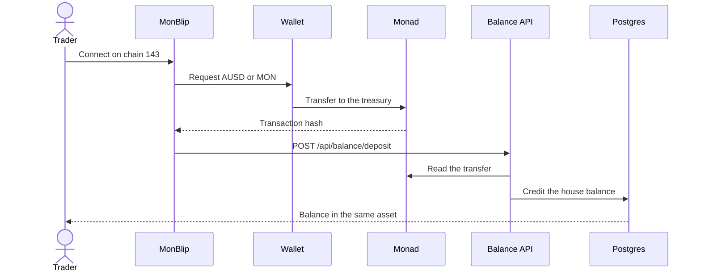

Transactions:

- [0.1 MON deposit to the treasury](https://monadvision.com/tx/0x9b269cba30ce21e422150d7d6da8f6d262e26e7dbcbe88b2d4b338fe815a4688)
- [0.1 AUSD deposit to the treasury](https://monadvision.com/tx/0xa7a24041f6794b733b3b41b11d67dfad14a10bf2aa2d6189e37037bc8f2432a5)
- [200 MON deposit to the treasury](https://monadvision.com/tx/0x9bb444cb85a1411bb39cf3fd5e60942f138ba639b1dc807ca7dc930f68b4a425)
- [0.99 MON withdrawal from the treasury](https://monadvision.com/tx/0xbbab889b4d50221ab01c2664f4c2c7572f1f7a233e4f86419720cae40e77f4ce)
- [4.95 MON withdrawal from the treasury](https://monadvision.com/tx/0xb9ef38e4d979674f7a0641741ea9c4d5f52e3e6e0d3a09a2624a86e79126a661)
- [0.099 AUSD withdrawal from the treasury](https://monadvision.com/tx/0x9989931c64245d90bb2b1efd8bf890041f4ec25a046166ae5b63930566f332b2)
- [1% deposit fee to the fee wallet, 0.001 AUSD](https://monadvision.com/tx/0x2b91665a02fc8f4f566910f7e57e62a88aee82ec84b40ea8f45ca87bb8fd4c2b)
- [1% withdrawal fee to the fee wallet, 0.05 MON](https://monadvision.com/tx/0x0079fe085b859d4dfd85352ae3b125acaba13a9e09ab566830961523fe08ea03)

### Mera

Mera is the human account. The passkey signs the deposit, the withdrawal, Send, and the trader's Perpl order. A second PRF salt encrypts the bet slip in the browser.

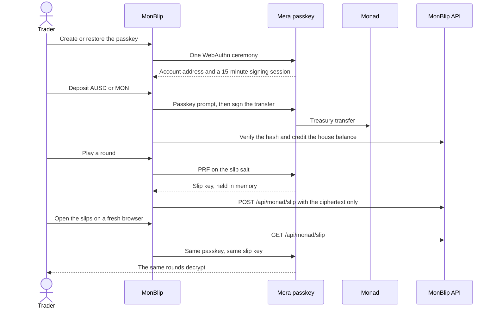

**Best Mera-Powered UX on Monad.** Mera is the entire account layer. A passkey creates the wallet, restores the session, and signs the Monad deposit, the withdrawal, Send, and the user's Perpl order. The passkey address is the house-balance key, so AUSD, MON, referrals and settled rounds belong to that account. MetaMask is the second way in. Dynamic never replaces the passkey.

- **One prompt to start.** "Create a passkey" is a single ceremony. No seed phrase, extension, or email code.
- **Scoped session.** A signing session lasts 15 minutes. A round and the Perpl order sign without a prompt. A deposit, a withdrawal, and Send ask for the passkey again and check it is the same account. When the session ends, the next action asks once.
- **Stateless.** The passkey is discoverable. With local storage cleared, or on a new device with a synced passkey, one prompt brings back the same address and balances.
- **Send.** Under the passkey wallet balance, Send moves every AUSD and all MON to another Monad address in one prompt. It previews the amounts, keeps a little MON for gas, sizes gas for smart-account recipients, and marks each transfer sent or failed with its transaction.

Transactions signed by Mera passkeys:

- [4.98 MON deposit to the treasury](https://monadvision.com/tx/0x802787970bafad5a4010cd5bf5c8ee92abc721ab0d14c16a4fdbf3ff9dde58f1)
- [0.99 MON withdrawal back to the passkey](https://monadvision.com/tx/0x6fea201042a7e2ca8a3eeb6bd328ed12c94ba33db934f4f673f6941e56580bec)
- [10 AUSD deposit to the treasury](https://monadvision.com/tx/0xd4e0f5c8e144737f1f0c678077c7f14453b5a0192d0b27f9763b2b93d2de5c19)
- [9.1872 AUSD withdrawal back to the passkey](https://monadvision.com/tx/0x2f6e4b8043ce35f454a172d8ca4a1b2ef28508cf48087f28c418fced274e2fe9)
- Send, 10 AUSD and 99.49 MON: [AUSD](https://monadvision.com/tx/0xd00c572ea63f5b129b9e40cb282f91120e2c7b6e86aff7c350b8949baeb35b33), [MON](https://monadvision.com/tx/0x4c2586b16db2c59d24e39f0fd659b5052a5e086e59dc8ec027b237747dcabdf2)
- Send, 9.1872 AUSD and 9.98 MON: [AUSD](https://monadvision.com/tx/0x8c4ff07b8f19e0eeaf896b206bffd6dd97a51dc6b920d1eedd564cf4c709b34d), [MON](https://monadvision.com/tx/0xdc3514523ce2b76e65d894a5470f899b4d20a256d6e5afe4397bf822685aedaf)

Demo: https://drive.google.com/drive/folders/1mhdRbF9Ee4ETzBAHmJ6SO1k9NrqHbwAF?usp=sharing

**Mera: One Passkey, Many Keys.** The same passkey has a second PRF namespace for the bet slip. That salt is separate from the spending key. The slip key is an AES-GCM key that stays in memory. It encrypts the direction, the stake and the asset in the browser. Only the ciphertext is stored, in the browser and in Supabase (`sealed_slips`) under the passkey address. On a fresh browser profile or a second device, the same passkey derives the same slip key and opens the same slips. A blob sealed under another salt does not open. That step is not a blockchain transaction.

Demo: https://drive.google.com/drive/folders/1KFzESdcv2whLmsGc79EKSV_g7gQgzQWH?usp=sharing

### MetaMask

MetaMask is the browser wallet on Monad, and a second path through the Agent Wallet plugin. The plugin never replaces the passkey.

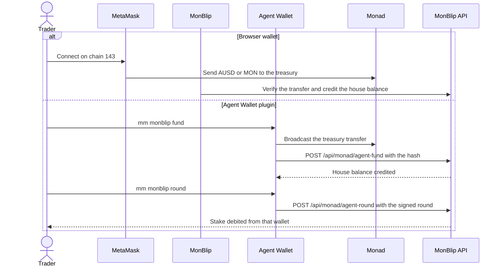

**Best Agent Wallet Plugin.** The plugin is the agent path. `mm monblip desk` reads the BTC quote with no wallet. `mm monblip fund` sends AUSD or MON to the Monad treasury through the Agent Wallet, then asks MonBlip to credit that exact transfer. `mm monblip round` stakes a capped 5s to 60s round from that house balance. The Agent Wallet signs the round text. MonBlip recovers the signer and debits that wallet. Every transfer and every stake goes through `mm`, including policy and MFA. The cap is 10 units. The desk is https://monblip.fun.

Transactions from the MetaMask browser wallet:

- [1 AUSD deposit to the treasury](https://monadvision.com/tx/0xeb7644c90e4afaaf4c11eba3c064ebacd4d8f0d1084cd088bd6d2f68e4493014)
- [200 MON deposit to the treasury](https://monadvision.com/tx/0x9bb444cb85a1411bb39cf3fd5e60942f138ba639b1dc807ca7dc930f68b4a425)
- [10 MON deposit relayed by MetaMask](https://monadvision.com/tx/0x15689462272abb9253ffde7aae035fd9a20c8fab94bb8a53a0f7038e4df95525), credited from the inner call to the treasury
- [0.2 AUSD deposit relayed by MetaMask](https://monadvision.com/tx/0x22bad841281dfd7845167546c45790d8c68724728a9b26d37e8807c177f6a18f)
- [10 AUSD top-up from MetaMask to a passkey](https://monadvision.com/tx/0xa5eb76d00f14268c5d1f3ed96eacf8d6fa02fbb03e8cf014d3d509de93a6a46a)

Skill file: https://github.com/AmaanSayyad/MonBlip/blob/main/plugins/mm-monblip/skills/monblip/SKILL.md

Demo: https://drive.google.com/drive/folders/1Prpgo-lHxlNzxHmTHhm7d94ZVu-62hrm?usp=sharing

### Agora

Agora AUSD is the stablecoin house balance. Native MON is the second play asset. Both credits follow the same deposit check.

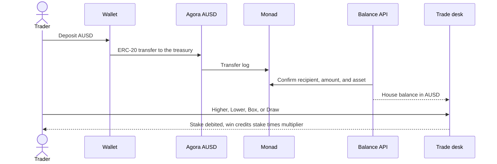

**Best Mobile Trading App on Monad.** MonBlip is the mobile short-chart desk. Mera is the passkey account. Agora AUSD is the stablecoin house balance, with native MON beside it. The trader deposits, sees that balance, and bets Classic, Box, or Draw at 5s, 10s, 15s, 30s or 1m without a signature on the stake. The same passkey opens Perpl at https://monblip.fun/perpl and places the MON perpetual. The house hedge is a separate Dynamic signature. A win credits stake times the multiplier. A withdrawal returns AUSD or MON from the Monad treasury. On /perpl the ticket shows the AUSD in the passkey and the free Perpl collateral. When that collateral is below 0.25 AUSD, the ticket adds 1 AUSD from the passkey, then places the 1 MON long and shows the fill or Perpl's reason. On a phone, "Add to Home Screen" installs MonBlip as a standalone app that opens on /trade.

AUSD transactions:

- [0.1 AUSD deposit from MetaMask](https://monadvision.com/tx/0xa7a24041f6794b733b3b41b11d67dfad14a10bf2aa2d6189e37037bc8f2432a5)
- [10 AUSD deposit from a passkey](https://monadvision.com/tx/0xd4e0f5c8e144737f1f0c678077c7f14453b5a0192d0b27f9763b2b93d2de5c19)
- [0.1 AUSD fee on that deposit](https://monadvision.com/tx/0x5673404cc2a1d67ce06a5f6407ab72b54c885762215b817f7c14bf281f3b6536)
- [9.1872 AUSD withdrawal to the passkey](https://monadvision.com/tx/0x2f6e4b8043ce35f454a172d8ca4a1b2ef28508cf48087f28c418fced274e2fe9)
- [2 AUSD withdrawal to MetaMask](https://monadvision.com/tx/0x59c82d048070619526dbc4ca5324ac8d9bc5dc5ddec386e33fd77e09fc05f580)
- [1 AUSD Perpl collateral top-up from a passkey](https://monadvision.com/tx/0xfae339777cf123771b851dc3805316c653caf52ef41d5956266fea917603b77c)

Demo: https://drive.google.com/drive/folders/1_Jvrra2rfWiGr4rMQQy6wHk05iv1pPw_?usp=sharing

### Aurora

Aurora Intents quotes a deposit and delivers MON on Monad. The fund screen keeps the quote and the destination transaction.

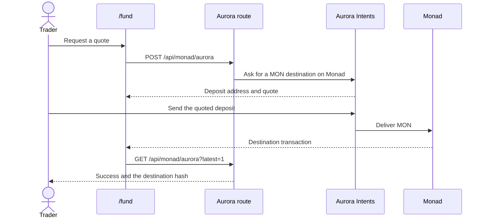

**Bring Any-Chain Liquidity to Monad.** https://monblip.fun/fund uses Aurora Intents. The trader picks the asset they hold, and Aurora delivers MON to the connected Monad wallet, including a passkey wallet. Five deposits have landed on Monad. That MON is a play asset on the desk: Deposit moves it into the house balance. The fund screen restores the quote, tracks the swap from sent to delivered or refunded, and shows the destination transaction. "Start a new deposit" opens the next quote.

A deposit on https://monblip.fun/fund, step by step. The trader picks a token and an amount, and Aurora quotes the MON:

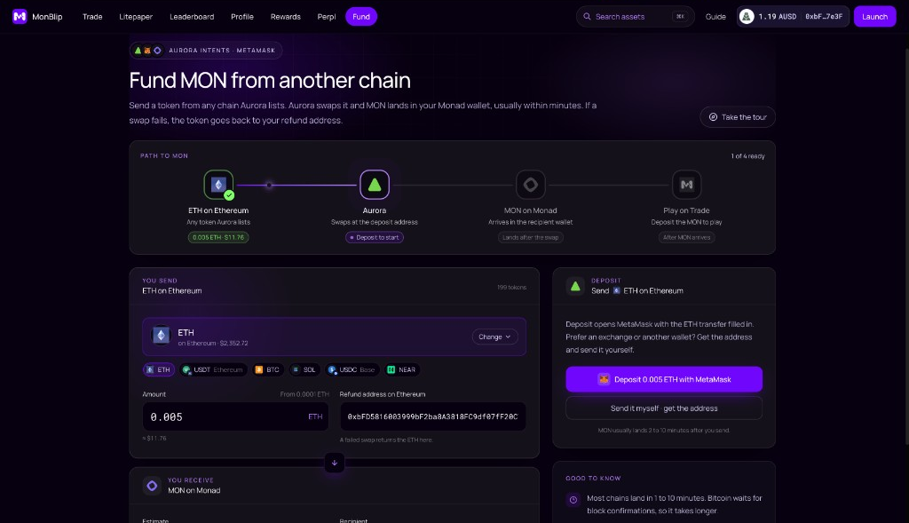

Deposit opens MetaMask with the transfer filled in, here 0.005 SOL on Solana to Aurora's deposit address:

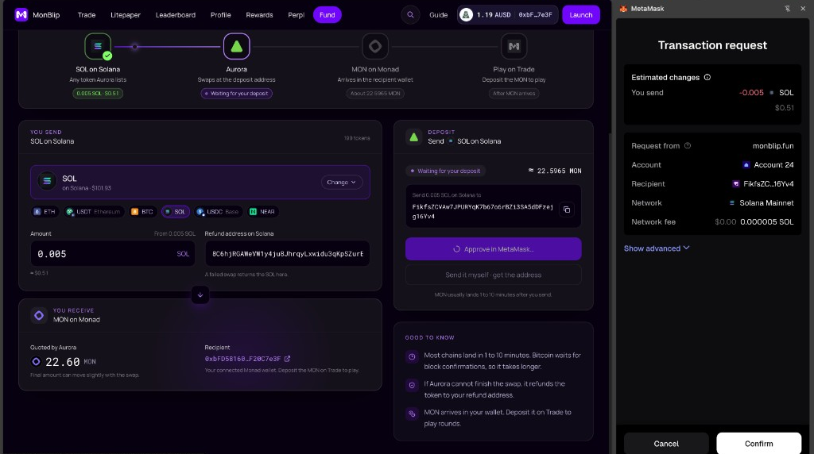

After MetaMask sends it, the page tracks the swap until MON lands in the passkey wallet:

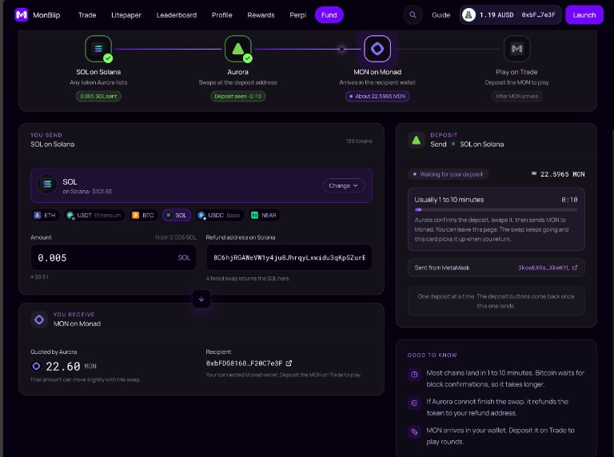

Aurora deliveries on Monad:

- [0.001 ETH became 101.59 MON in the MetaMask wallet](https://monadvision.com/tx/0xbc3655c328f912cf97385d987c172ae95c2cce46dadc9fc9a9cb3978464a220c)
- [0.01 SOL became 43.60 MON in a passkey wallet](https://monadvision.com/tx/0x26adfb618aa38aed3b82dfc0dd2ca3635bed03ff38478c0c0c004f23486d50cb)
- [0.01 SOL became 43.44 MON in a passkey wallet](https://monadvision.com/tx/0xd2d4b05f0d8aeb4ecb64fb64c8cdba9418ecedc00f9ab91485596a3037a75504)
- [$0.52 of SOL became 21.85 MON in the MetaMask wallet](https://monadvision.com/tx/0x244f270d0e445e0b37a20da1385dcdc4d9e4ed7b4a1f99d0e60d3549dba87cc9)
- [$0.52 of SOL became 21.60 MON in a second passkey wallet](https://monadvision.com/tx/0x7030ef2fd48ef1e006d10732ca94ab08b5c9f66f154d1caa322c9e9e97fc669a)

The MonBlip key on the Aurora Intents portal shows the same five swaps, each a success, from SOL and ETH into MON on Monad:

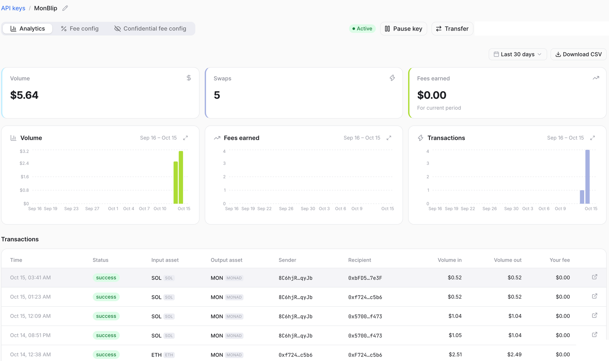

The portal's user analytics for the key, with SOL and ETH as origins and MON on Monad as the only destination:

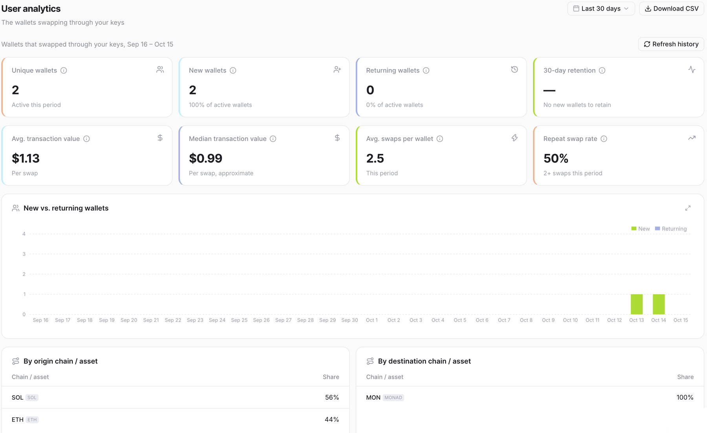

Demo: https://drive.google.com/drive/folders/1RY03y8f1AtsP0YX_3Y3Q4BTI9CLzK4Le?usp=sharing

### Envio

Envio HyperSync is what fills the profile. It reads AUSD transfers and native MON transfers between the trader and the treasury.

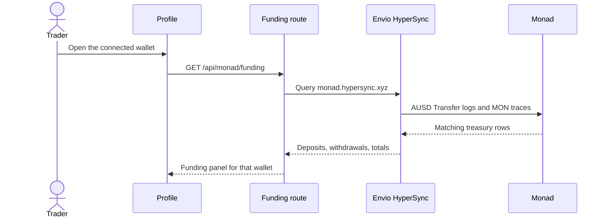

**Best Use of Envio.** Envio HyperSync is what fills the profile. For the connected wallet it reads AUSD transfers and native MON transfers against the Monad treasury and shows deposits, withdrawals and totals. The route is `/api/monad/funding`. The panel stays empty until that query returns. The data is the feature.

The profile's "On-chain funding" panel for the test wallet, filled by HyperSync:

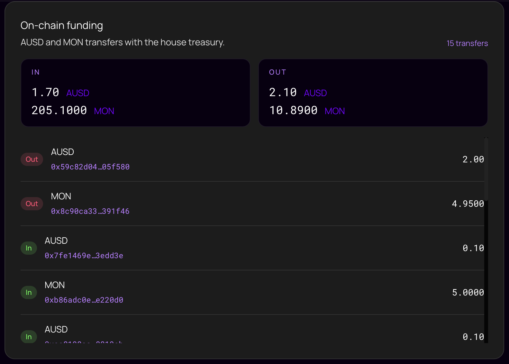

The same data from the live route, tagged `envio-hypersync`:

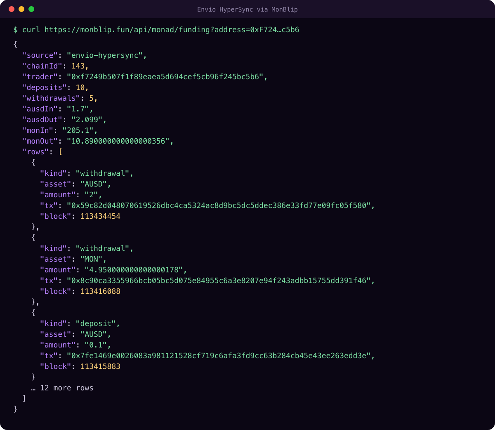

The MonBlip HyperSync token on the Envio dashboard, with 170 data requests on Monad in the last 24 hours:

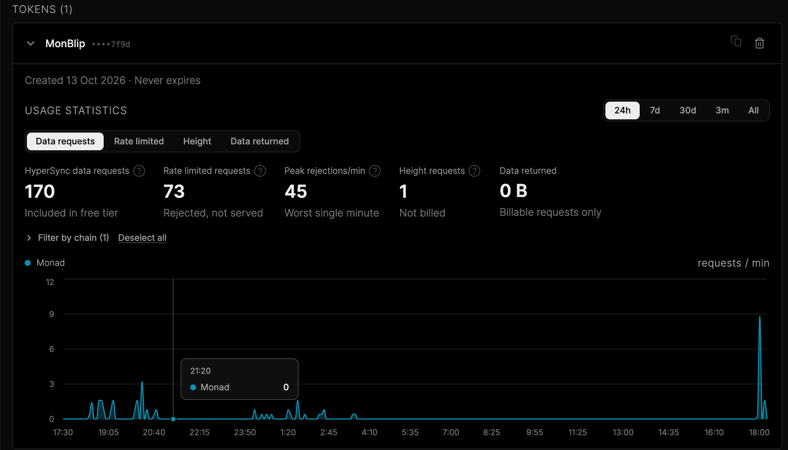

Live query for the test wallet: https://monblip.fun/api/monad/funding?address=0xF7249B507F1f89Eaea5d694cEf5cb96F245Bc5b6. It returns 10 deposits and 5 withdrawals, each with its transaction, for example:

- [AUSD deposit row](https://monadvision.com/tx/0xa7a24041f6794b733b3b41b11d67dfad14a10bf2aa2d6189e37037bc8f2432a5), read from the AUSD Transfer log
- [MON deposit row](https://monadvision.com/tx/0x9b269cba30ce21e422150d7d6da8f6d262e26e7dbcbe88b2d4b338fe815a4688), read from the native transfer
- [MON withdrawal row](https://monadvision.com/tx/0x8c90ca3355966bcb05bc5d075e84955c6a3e8207e94f243adbb15755dd391f46), read from the treasury payout

Demo: https://drive.google.com/drive/folders/1E2u1OwedGb_gU-Da8Y2DzZKURsjdUX7D?usp=sharing

### Chainlink CRE

CRE closes the round. The workflow reads a public BTC price, reads AUSD decimals on Monad, and posts the close to the desk. CRE CLI simulations have completed. The workflow is not registered on the CRE network yet.

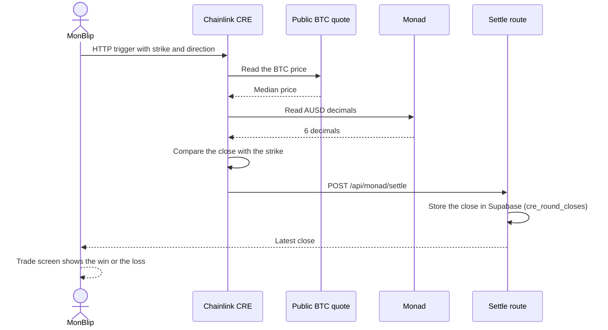

**Best workflow with CRE.** Chainlink CRE is the orchestration layer for the close. The workflow reads a public BTC price, reads AUSD decimals on Monad mainnet, and posts the strike, the close, and the win or loss to https://monblip.fun/api/monad/settle. The route stores each close in Supabase, so every server shows the same latest close, and the trade screen shows it on the CRE line. A CRE CLI simulation completed with BTC at 83340, a strike of 100000, and a loss. The round settles in under 5 seconds against the public quote.

Run the simulation from `cre/`. The single `.env` at the repo root holds `CRE_ETH_PRIVATE_KEY`.

```bash
cre workflow simulate round-close -e ../.env --target staging-settings --non-interactive --trigger-index 0 --http-payload payload.json --skip-type-checks --allow-unknown-chains
```

After the simulation passed, we asked Chainlink Labs for CRE deployment access. On 14 October Chainlink replied that CRE workflows can already be simulated locally, and that deploying on testnet or mainnet comes with commercial conditions. The workflow is ready to register once that access is in place.

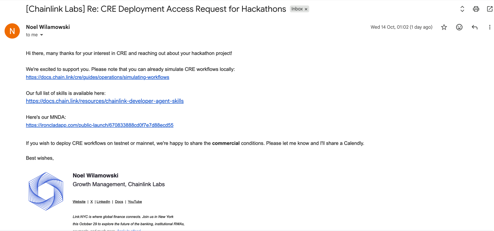

Demo: https://drive.google.com/drive/folders/10yTXQu5zgfS-exvnEHIPNn_BE5zOj3xI?usp=sharing

### Dynamic

Dynamic signs the house hedge. It is not the trader login. The hedge wallet is an MPC account, and the trade key is Ed25519.

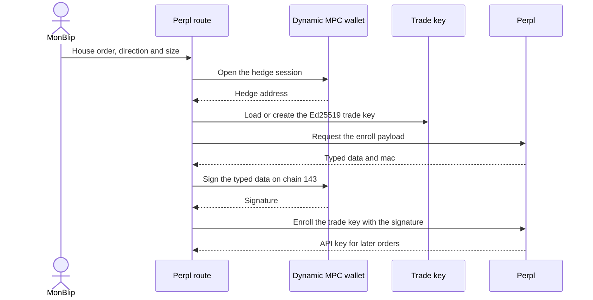

**Best Use of Dynamic.** Dynamic is the house hedge signer. The trader logs in with a Mera passkey or MetaMask. The hedge is a Dynamic MPC server wallet, `0xdfE8C57CfC2900f74D3a513DBd075F5e6970fc00`, which owns Perpl account #5489. It signs Perpl's typed data on Monad and enrolls a trade-scoped Ed25519 key for the next orders. Perpl accepted a house order from that account, a 1 MON short. Every server signs as the same wallet, because its key-share metadata is kept in a hidden host variable. After each AUSD round, the Dynamic line on the trade board shows the signer, the signature, and Perpl's answer. When the house account has no free collateral, Perpl refuses the hedge and the board shows that reason. The route is `/api/monad/perpl`. No raw hedge key sits in the app.

Transactions signed by the Dynamic hedge wallet:

- [AUSD approval for Perpl](https://monadvision.com/tx/0xf46b33b90dbd36978bb6093d9b71541e19292baf2900bbe71f386a6e78b9a7f4)
- [createAccount with 10 AUSD, Perpl account #5489](https://monadvision.com/tx/0x78aa18f8bca1a4e0a0c8308a7726e2b60ed10b346ecf366a935eafb9e4382445)
- [10 AUSD collateral withdrawal from Perpl](https://monadvision.com/tx/0xe9145d0d48ae5bd74ac2c3550439dc068088ccdfbe2ffaad05283ee09a939142)
- [11 AUSD transfer to the test wallet](https://monadvision.com/tx/0x5d5edfb97590d03d33b34021e0694b1f5bf21c02688fd033f3bcc82562a486c0)
- [0.938 MON transfer to the test wallet](https://monadvision.com/tx/0x3a76012fc73229c17bbbeef187540ce64f8af16def86f0f320d6225e08cae79e)

The wallet was funded with [11 AUSD](https://monadvision.com/tx/0x833eb49c80c22e17e50be125a5085ca2f815002d25983132b079681e35f6855a) and [1 MON for gas](https://monadvision.com/tx/0x6e6c217f98aa3d21e4594a50b80beb0eb77fb620fc6964273389e488711c9382).

Demo: https://drive.google.com/drive/folders/1XLaaqPHH0E0TNF-RXmCNHkNmJUwu5VTi?usp=sharing

### Perpl

Perpl is the MON perpetual. The trader opens an account from the Mera passkey and places a 1 MON long. The house hedge is signed by Dynamic.

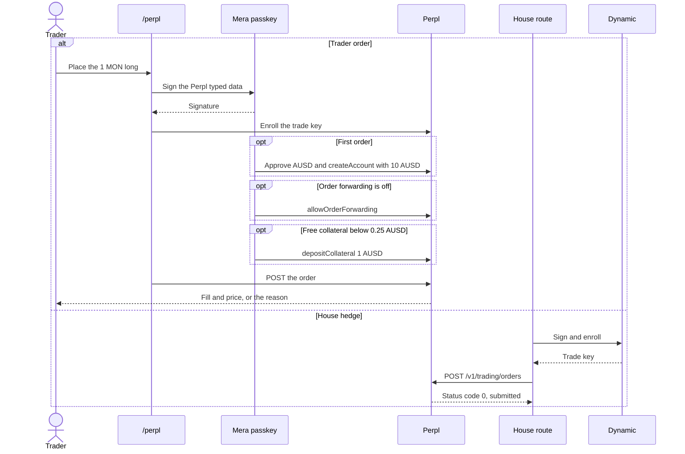

The ticket at https://monblip.fun/perpl shows the passkey's AUSD and the free collateral, and links each on-chain step. The account card below it shows open positions and order history, and withdraws free collateral back to the passkey. A passkey listed in `PERPL_CLAIM_ADDRESSES` can claim the house account's collateral to itself through `POST /api/monad/perpl/claim` with a fresh signature. The Perpl routes run from the `bom1` region.

The 1 MON long from passkey `0xbFD5…7e3F` on Perpl account #5506. Every step on the path is done, and the long is open:

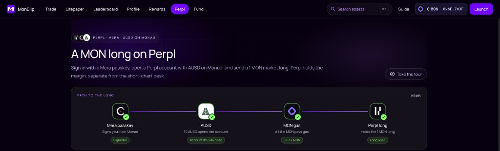

The order ticket next to the MON perpetual chart. The passkey approves the Perpl trade key. When the account has no free collateral, the ticket adds 1 AUSD from the passkey before the long:

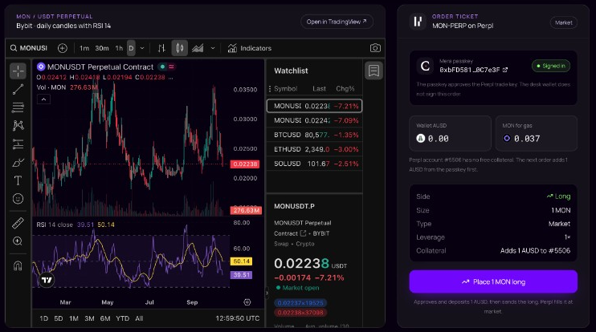

The account card, read from Perpl. The open position is a 1 MON long at an entry of $0.024138. The history lists the settlement of that long, the collateral moves with their transactions, and a later long that Perpl refused with its reason:

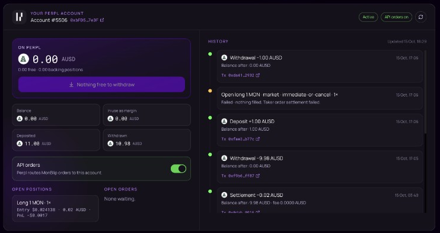

Perpl settled the long on-chain in [this transaction](https://monadvision.com/tx/0x0dab02fae8852c4dc177d2a9fe2425f6d3da062033df4b3c43c6fd29f7d90916), one second after the passkey turned on order forwarding.

Passkey transactions on the Perpl exchange (`0x34B6552d57a35a1D042CcAe1951BD1C370112a6F`):

| Step | Account #5501 | Account #5506 |
|---|---|---|
| AUSD approval | [tx](https://monadvision.com/tx/0x4440a3834707294a5a0578422ac5eee18c5b6087734910015c6371d3cf7f7995) | [tx](https://monadvision.com/tx/0x6f17d2aaaa2634d25231b41df15f372339d97e52ba09e4e2ef1f24cc8fd16d0e) |
| createAccount with 10 AUSD | [tx](https://monadvision.com/tx/0x2a16b5ee6f47e1ef06f84f773210964e4b0a2273b8f29b673b0e94952171a251) | [tx](https://monadvision.com/tx/0xa9442bbd41dcde97cbdb954746153195cbb760fa4fb1d579c919331d53692c30) |
| allowOrderForwarding | [tx](https://monadvision.com/tx/0xc446e8c3abff8e54d894da3090178f1a5ed0489a2aa0c9fa03214425718be81d) | [tx](https://monadvision.com/tx/0xad92493d7ab4f6977e52550cd8c5c1b14e9ca75c12ae7929d881a1b48d4e8b2d) |
| 1 MON long settled by Perpl | | [tx](https://monadvision.com/tx/0x0dab02fae8852c4dc177d2a9fe2425f6d3da062033df4b3c43c6fd29f7d90916) |
| depositCollateral 1 AUSD | | [tx](https://monadvision.com/tx/0xfae339777cf123771b851dc3805316c653caf52ef41d5956266fea917603b77c) |
| withdrawCollateral to the passkey | [10 AUSD](https://monadvision.com/tx/0x0083303659e60ebef2a8cc29a32944ce9accd4abf9378e01f722fd6b93ae4ce6) | [9.9758 AUSD](https://monadvision.com/tx/0xf9b6811491adf2a6ad1f6cf681f91a2b9b89d1d0de0e6d89dc5c461ace25ff87), [1 AUSD](https://monadvision.com/tx/0xda4118eb09db6c7ed5cb85b8f70adc8615f3621acc8d2bd8e3d2a19d0add2932) |

The house account #5489 was opened by the Dynamic wallet in [this transaction](https://monadvision.com/tx/0x78aa18f8bca1a4e0a0c8308a7726e2b60ed10b346ecf366a935eafb9e4382445).

### Nansen

Nansen turns a settled wallet into a trading stance on the public board and on the trade screen.

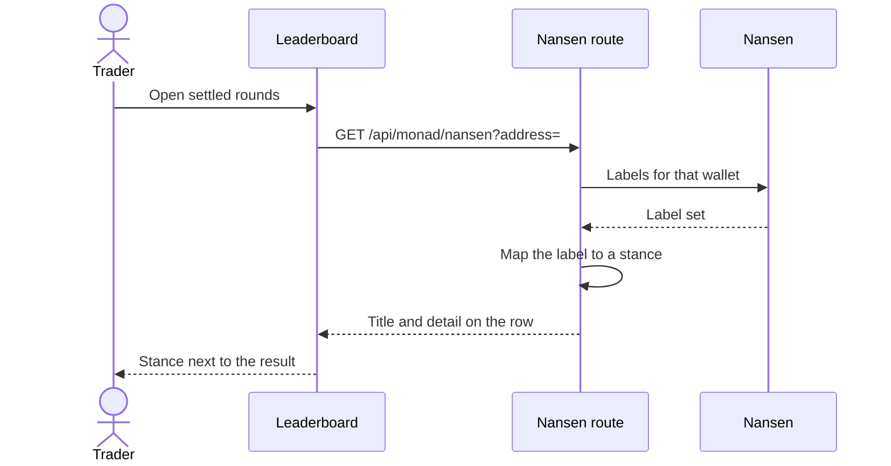

**Best use of Nansen.** After a round settles, the public board calls the Nansen labels API for that wallet. The label becomes the trading stance on the leaderboard and on the trade screen. A venue wallet and an unknown wallet read differently. The route is `/api/monad/nansen`. The board still lists results if the key is missing. The stance is the feature.

The live board, with 65 settled Monad rounds from 3 traders. The line under each wallet is its Nansen stance. These are fresh test wallets, so Nansen has no label for them yet:

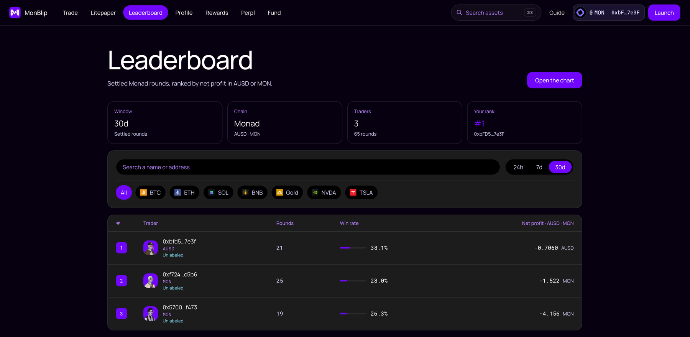

The Nansen dashboard shows the route's calls to `/api/v1/profiler/address/labels`, the same endpoint MonBlip uses, each one a success:

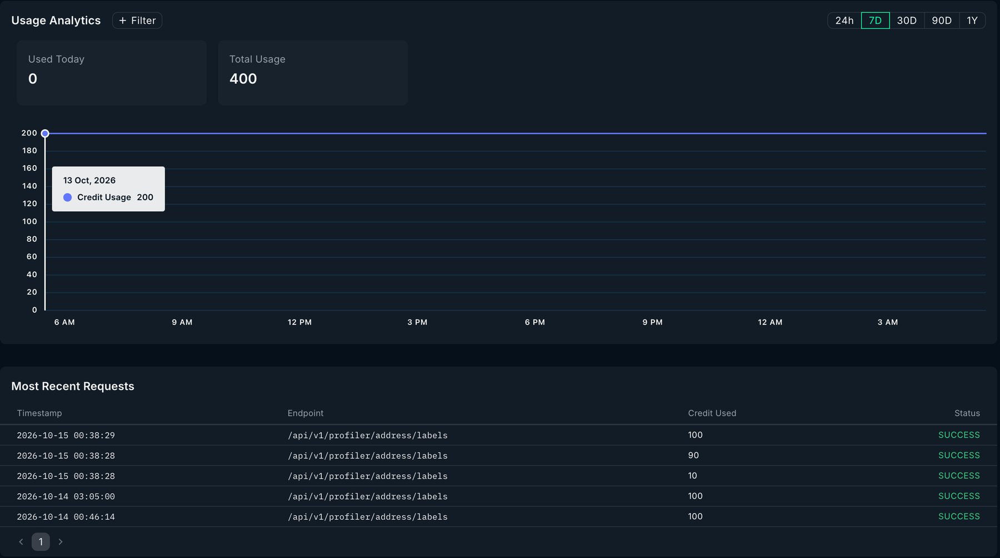

The API runs on 10,000 purchased credits:

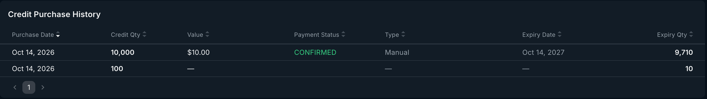

Demo: https://drive.google.com/drive/folders/14CgTT_e6neN-ATLj65MPqjhP_x82j2PM?usp=sharing

---

## Story and inspiration

The founder used a Web2 binary desk. A paper-mode account showed a win. The same style of round, played with real money, lost. Public threads about that product described trial results that did not match what people saw once real money was on the line. The price that settled the round was not a chart the trader could check.

That gap sat for about five years. A round of a few seconds needs a public price that is already there when the window closes, and a place to hold the stake that does not ask for a wallet signature on every tick. Monad mainnet is that place. AUSD and native MON are the play assets. The deposit and the withdrawal are the onchain transfers. The round itself settles from the house balance against the chart.

MonBlip is that desk. A trader deposits AUSD or MON, takes Higher or Lower, a Box tile, or a drawn band, and a round of 5 seconds to 1 minute settles in the open.

---

## The problem

Binary rounds are short, and the products around them are not.

- The price that settles the round is often hidden. The trader cannot line it up with a chart they can see.
- A paper account and a real-money account can tell two different stories. A win in one does not mean the same round would have paid in the other.
- A round lasts a few seconds. A wallet signature on every stake is slower than the round, so the tick sits waiting on a confirmation that should not be part of the bet.
- Crypto, stocks, metals, and FX live in different products. A person who watches all of them has no single short-chart desk.
- When a payout does come back, it has to be the same asset the trader deposited, from a treasury they can see on Monad.

---

## The solution

MonBlip separates funding from the round.

1. The trader connects MetaMask or a Mera passkey on Monad.
2. They deposit AUSD or MON into the Monad treasury and receive a house balance in that asset.
3. Classic, Box, and Draw debit that balance. There is no wallet signature on the stake.
4. The round settles against the live chart. A win credits `stake × multiplier`. A miss pays zero. A tie on Classic pays zero.
5. A withdrawal sends the same asset from the Monad treasury back to the wallet.

The chart fills a price from a public quote. A missing quote stays blank and is not settled. The chart asks about once a second. Chainlink CRE closes the round. There is no project token. The play assets are Agora AUSD and native MON on Monad.

---

## Who it is for

| Reader | What they use MonBlip for |
|---|---|
| Wallet traders | A 5s to 60s round on Monad without a signature on every stake |
| People who want a public price | A round they can check against the chart, with funds in their wallet until they deposit |
| Stock, metal, and FX watchers | The same chart for equities, metals, and FX, settled from the Monad house balance |
| People burned by a hidden settlement | A desk where the paper path and the paid path use the same visible price |
| Operators | The dashboard for treasury balances, the review queue, and invite codes |

---

## Features

- One chart for crypto, stocks, metals, and FX.
- Classic Higher/Lower, Box tiles, and Draw rectangles.
- Blitz on Box: a $0.10 entry, paid to the Monad treasury, with marked cells at 2×.
- Demo balance in the browser, kept out of the live ledger.
- SMA 20, Bollinger bands (20, 2), Alligator, and RSI 14 on the same ticks.
- One AUSD house balance and one MON house balance per wallet.
- Deposits and withdrawals at 1% (Free), 0.9% (Standard), and 0.8% (VIP).
- Withdrawals at or under $10 pay immediately. Above $10 they wait for review.
- Referrals are on `/referrals`.

---

## Classic

Select Higher or Lower, set the window, and stake from the house balance.

The strike is the chart price when the round starts.

- Higher wins when the close is above the strike.
- Lower wins when the close is below the strike.
- A tie pays zero.

| Window | Multiplier |
|---|---|
| 5s | 1.75× |
| 10s | 1.80× |
| 15s | 1.85× |
| 30s | 1.90× |
| 60s | 1.95× |

At 1.90×, a trader breaks even near a 52.6% win rate. Shorter windows pay less and need a higher win rate to break even.

---

## Box

The live chart shows a grid of tiles. Each tile is a price band and shows its multiplier. The trader taps a tile.

A tile defines `priceBottom`, `priceTop`, the moment the price line reaches that column, and the multiplier.

The round wins when the live price is inside that band as the line reaches the tile. A tighter band pays more. A wider band is easier and pays less. Corner tiles, farther from the current price, pay more because the line is less likely to land there.

Blitz can mark cells in the active window at 2×.

---

## Draw

The trader draws a rectangle to the right of the live price. The rectangle is their own band and time window. The multiplier is shown as the box is drawn.

The rectangle defines `priceBottom`, `priceTop`, `startTime` on the left edge, and `endTime` on the right edge. The left edge has to sit in the future.

The round wins when the price stays inside `[priceBottom, priceTop]` from the left edge through the right edge.

The multiplier rises when the box is smaller, farther from the current price, or shorter. The box cannot be taller than 20% of the chart or wider than 20 seconds. A box that is too small to draw is rejected.

---

## Blitz

Blitz is an overlay on Box, not a fourth mode.

```
[──── BLITZ ACTIVE (1 min) ────][──── COOLDOWN (2 min) ────][── BLITZ ACTIVE ──]
```

The entry fee is **$0.10**, paid once per window, on Monad, in AUSD or MON, to the **Monad treasury**. It is not taken from the house balance, and it is not sent to the platform fee wallet.

During the active minute, marked cells pay 2× on top of the tile multiplier. AUSD charges exactly $0.10. MON charges the amount that equals $0.10 at the current price.

---

## Treasury

The desk is Monad mainnet, chain ID 143. A transfer arrives only if it is sent on Monad. Secret keys stay in `.env` and in the host environment. They are not in this file.

Platform fees do not stay in the treasury. They move to the fee wallet.

| Wallet | Address |
|---|---|
| Treasury | `0xcbae80461bb820e4075035f765f8a46fa65a6ded` |
| Fee wallet | `0x9B4d9039A96Bfd7320C865aaCC69F35b51f425a7` |
| AUSD | `0x00000000eFE302BEAA2b3e6e1b18d08D69a9012a` |

---

## Settlement architecture

```
┌─────────────────────────────────────────────────────────────┐
│  OFF-CHAIN (Supabase)                                       │
│  user_balances          balance per wallet and asset        │
│  balance_audit_log      every debit and credit              │
│  bet_history            settled rounds                      │
│  user_sessions          time on the desk                    │
│  sealed_slips           Mera slip ciphertext per address    │
│  cre_round_closes       Chainlink CRE round closes          │
└─────────────────────────────────────────────────────────────┘
         ▲
         │  balance RPCs and session pings
┌────────┴────────────────────────────────────────────────────┐
│  CLIENT (Next.js + Zustand)                                 │
│  Chart price: the first public quote that answers           │
│  Round state: active rounds and settled rounds              │
│  Resolution: the chart price at the end of the round        │
└──────────────────────────────────────────────────────────────┘
         ▲
         │  deposits, withdrawals, and the Blitz entry
┌────────┴────────────────────────────────────────────────────┐
│  ON MONAD                                                   │
│  One treasury holds deposited AUSD and MON                  │
│  The fee wallet receives the deposit and withdrawal fee     │
│  The Blitz $0.10 goes to the Monad treasury                 │
└─────────────────────────────────────────────────────────────┘
```

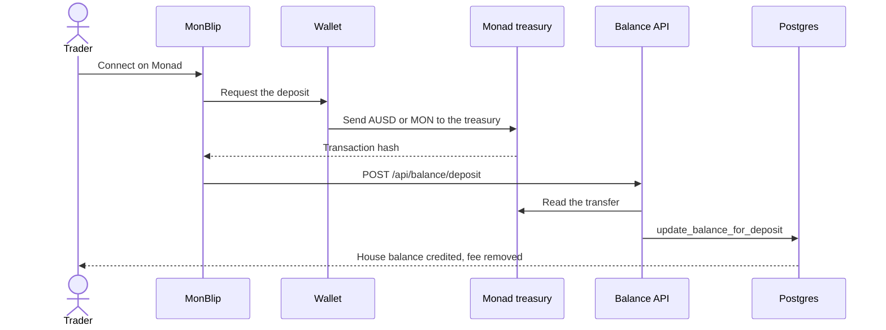

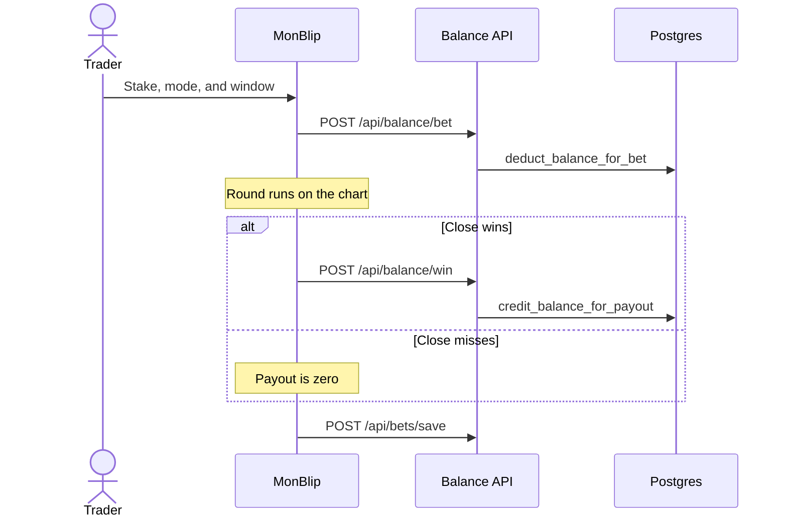

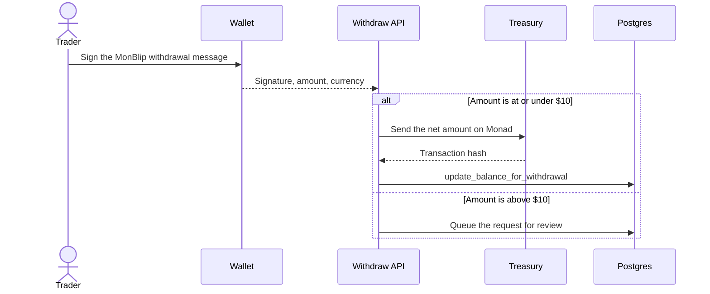

The Monad withdrawal message is:

```
MonBlip withdrawal authorization
address:${address}
amount:${amount.toFixed(8)}
currency:${currency}
signedAt:${signedAt}
```

The server rejects a signature older than five minutes. A mainnet withdrawal cannot exceed `total deposited × 1.08`.

---

## Tech stack

| Frontend | Wallets | Server | Tooling |
|---|---|---|---|
| Next.js 16, App Router, Turbopack | MetaMask and a Mera passkey on Monad, viem | Next.js route handlers on Vercel | ESLint 9 |
| React 19 and TypeScript | Dynamic Node SDK for the hedge signer | Supabase Postgres and RPCs | Jest and Testing Library |
| Installable web app manifest | MetaMask Agent Wallet plugin (`plugins/mm-monblip`) | Aurora Intents, Envio HyperSync, Nansen, Perpl | Chainlink CRE workflow in `cre/` |
| Tailwind CSS v4 | | Public quotes for the chart | Yarn v1 through Corepack, Node 22 |
| Zustand | | viem for Monad treasury sends | Vercel Analytics and Speed Insights |
| TanStack Query, Framer Motion, d3-shape | | PostHog | |

---

## Monetization

MonBlip earns on flow. There is no project token.

### 1. Platform fees

Deposits and withdrawals pay a tier fee. The fee moves from the treasury to the fee wallet. It is not left in the treasury.

| Tier | Fee |
|---|---|
| Free | 1% |
| Standard | 0.9% |
| VIP | 0.8% |

`calculateFeeAmount` floors the fee to 8 decimals.

### 2. Round pricing

Classic multipliers sit below 2×. At 1.90×, break-even is about a 52.6% win rate. At 1.75×, break-even is about 57.1%. Box and Draw pay more when the band is tighter or farther from the current price. The admin gameplay tab separates live rounds from demo rounds.

### 3. Blitz entry

$0.10 once per window, in AUSD or MON, sent to the Monad treasury.

These figures are the live rates. They are not a forecast of volume.

| Monthly round volume, if it is reached | Fee plus round-pricing range used for planning |
|---|---|
| About $5M | About $250k to $500k |
| About $20M | About $400k to $2.0M |

---

## Market

The desk is for people who already watch a chart and want a round that ends while they are still looking at it. The window is 5, 10, 15, 30, or 60 seconds. The markets on that chart are crypto, stocks, metals, and FX. The money is a house balance in AUSD or MON on Monad.

That is a different use than a position left open for hours. The trader is deciding a direction, a tile, or a band, and the result is the chart a minute later. The balance stays in the wallet until a deposit, and a withdrawal returns the same asset from the Monad treasury.

The planning ranges in [Monetization](#monetization) and [Go to market](#go-to-market) are targets for that loop: a deposit, a run of short rounds, and a withdrawal. They are not current results.

---

## Competitive landscape

| | Web2 binary desk | Leveraged perp | MonBlip |
|---|---|---|---|
| Settlement price | Often hidden from the trader | The venue's mark | The public chart |
| Paper vs paid | A demo account can diverge from the paid account | One account, with funding and liquidation | Demo stays in the browser. Paid rounds use the house balance and the same chart |
| Time in the position | Seconds to minutes, inside a closed app | Hours, with funding | 5 seconds to 1 minute |
| Signature on the stake | An in-app click | A transaction, or a session key | No wallet signature on the stake. The deposit and the withdrawal are the Monad transfers |
| Downside | The stake | The stake, plus liquidation | The stake. No leverage and no liquidation |
| Payout asset | The app's balance | The margin asset | The same AUSD or MON that was deposited |

MonBlip does not match a trader against a hidden feed, and it does not turn a short chart into a leveraged position. The price is the chart. The payout is the house balance on Monad.

---

## Roadmap

| Next | What it changes |
|---|---|
| More markets | More crypto, FX, stocks, and commodities on the same Monad chart |
| P2P Classic | Match a round between traders instead of only against the house balance, so the treasury is not the only backstop |
| Optional leverage | A 1× to 100× stake multiplier, off by default |
| Trader profiles | Highest P&L, most accurate, largest risk |
| Tournaments | Optional scheduled boards |
| Social trading | Follow, copy, and a public board |
| Native mobile | A store app on top of the installable web app |

The longer aim is a public binary board for stocks, FX, and crypto on Monad, with the price and the payout visible.

---

## Go to market


| # | Segment | Who they are | What they use today | MonBlip hook | Channel |
|---|---|---|---|---|---|
| 1 | DeFi traders | Options, spot, and perps | Funding, liquidation, and a slow ticket | A 5s round, no liquidation, no signature on the stake | Trading groups and Telegram |
| 2 | Chart traders | People who want a short round they can check | A book they cannot check | A public chart price and a Monad wallet | Monad community |
| 3 | Creators and communities | Trading groups that want a clip, not a whitepaper | No on-chain binary loop | Box, Draw, Blitz, and a shareable result | Short clips and ambassadors |
| 4 | Monad | Traders already on Monad | No short binary round on a public chart | AUSD and MON as the play assets | Monad community |

### Phase 0

Invite testing on Monad. Fee routing, settlement, and the house balance are the checks that matter. PostHog is wired for landing, demo, deposit, and round.

### Phase 1

| Action | Detail |
|---|---|
| Referral link | `/referrals` counts one new wallet when it registers |
| Demo | A full round with no wallet, then a deposit into the real balance |

### Phase 2

Ambassador notes, a weekly conversation with traders, Blitz windows with a stated prize if one is funded, public profiles, and a Telegram note before a Blitz window.

### Phase 3

P2P Classic, more assets, and a native mobile app. Wallet entry through a Mera passkey or MetaMask is already live.

| Mechanic | How it works |
|---|---|
| Referral link | A new wallet that arrives from `?ref=` is counted once |
| Demo then deposit | The round can be tried before a treasury transfer |
| Blitz window | One minute on, two minutes off, so the desk has a reason to be open |
| Monad | The desk, the treasury, and the community are the same network |
| Result clips | A settled round is a screenshot, not a thread |

Planning ranges, not current results:

| | Conservative | Middle | Optimistic |
|---|---|---|---|
| Average deposit | $50 | $150 | $400 |
| Fee on that deposit at 1% | $0.50 | $1.50 | $4 |
| Average withdrawal | $40 | $120 | $350 |
| Fee on that withdrawal at 1% | $0.40 | $1.20 | $3.50 |
| Blitz entries per user each month | 2 | 5 | 15 |
| Blitz fees | $0.20 | $0.50 | $1.50 |

---

## Why now

| Signal | Detail |
|---|---|
| The chain | Monad mainnet is the desk. AUSD and MON are the play assets. |
| The product | Deposits, house balances, and withdrawals run on the Monad treasury. |
| The gap | A short round on Monad can settle from a public chart and a house balance in AUSD or MON. |

---

## Team and company

MonBlip is a company. It is a long-term product. The hackathon is a public checkpoint, not the end of the desk.

The founder is one person: Amaan Sayyad, a blockchain developer and entrepreneur in Navi Mumbai, India.

| | |
|---|---|
| Role | Solo founder |
| Experience | 50 hackathon wins, 10+ shipped Web3 products, 3 times a founder, 8 companies, 12 times a speaker, 3 grants. Research papers, copyrights, and patents. |
| Location | Navi Mumbai, India |
| Email | amaansayyad2001@gmail.com |
| X | https://x.com/amaanbiz |
| MonBlip on X | https://x.com/MonBlip |
| GitHub | https://github.com/AmaanSayyad |
| LinkedIn | https://www.linkedin.com/in/amaan-sayyad- |
| Portfolio | https://amaansayyad.com |
| Telegram | https://t.me/amaan029 |

The problem came from using a Web2 binary app. That account is in [Story and inspiration](#story-and-inspiration): a paper-mode win, a real-money loss, and public threads about trial results that did not match real results. The five-year wait was for a public price fast enough to settle a short round.

The same person is building the company because that loss is personal, and the work since then is shipping Web3 products, founding companies, and presenting the work. MonBlip is the product of that, not a one-week prototype.

Demand and distribution are in [Go to market](#go-to-market). The desk, the treasury, and the community are on Monad. A trader can run a demo round before a deposit, and a referral link counts a new wallet.

---

## Environment

One file: `.env`. Do not add `.env.local` or `.env.example`. Next.js would let `.env.local` override `.env`. Do not commit `.env`.

`DASHBOARD_PASSWORD` must be quoted in `.env` if the value contains `#`. On the host, enter the same value without the quotes.

| Use | Names |
|---|---|
| App | `NEXT_PUBLIC_APP_URL`, `NEXT_PUBLIC_ROUND_DURATION`, `NEXT_PUBLIC_PRICE_UPDATE_INTERVAL`, `NEXT_PUBLIC_CHART_TIME_WINDOW` |
| Monad | `NEXT_PUBLIC_MONAD_TREASURY_ADDRESS`, `MONAD_TREASURY_SECRET_KEY` |
| Fee wallet | `NEXT_PUBLIC_PLATFORM_FEE_WALLET_EVM` |
| Database | `NEXT_PUBLIC_SUPABASE_URL`, `NEXT_PUBLIC_SUPABASE_ANON_KEY`, `SUPABASE_SERVICE_KEY` |
| Settlement | `BALANCE_SETTLEMENT_SECRET`, `BALANCE_INTERNAL_SECRET` |
| Admin | `DASHBOARD_PASSWORD` |
| Aurora | `AURORA_INTENTS_API_KEY`, `AURORA_MONAD_AUSD_ASSET` |
| Envio | `ENVIO_API_TOKEN` |
| Nansen | `NANSEN_API_KEY` |
| Dynamic | `DYNAMIC_ENVIRONMENT_ID`, `DYNAMIC_AUTH_TOKEN`, `DYNAMIC_WALLET_PASSWORD`, and on the host `DYNAMIC_HEDGE_WALLET` |
| Perpl | `PERPL_CLAIM_ADDRESSES` |
| Chainlink CRE | `CRE_WEBHOOK_SECRET`, and `CRE_ETH_PRIVATE_KEY` for the CLI |
| Payout policy | `PRIVY_APP_ID`, `PRIVY_APP_SECRET`, `PRIVY_PAYOUT_WALLET_ID`, `PRIVY_AUTHORIZATION_KEY` |
| Analytics | `NEXT_PUBLIC_POSTHOG_KEY`, `NEXT_PUBLIC_POSTHOG_HOST` |

Mera needs no key. Its passkeys are bound to the site's domain, so a passkey made on localhost is a different account from one made on monblip.fun. `docs/ENVIRONMENT.md` has the details.

---

## Run locally

Node 22. Yarn through Corepack.

1. Install dependencies.

```bash
corepack yarn
```

The `postinstall` step gives Mera its own `@noble/hashes` 2.2.0. Without it, Mera rejects every passkey key.

2. Keep a single `.env`. Use the Monad treasury address in the table above. Put secret keys only in `.env`.

3. Apply `supabase/migrations/` to the Supabase project, through `013_sealed_slips.sql`. Balances, rounds, referrals, CRE closes, and sealed slips read those tables.

4. Fund the Monad treasury with AUSD and MON.

5. Start the app.

```bash
npx next dev --port 3010
```

Open http://localhost:3010.

```bash
corepack yarn build
corepack yarn lint
corepack yarn test
```

The local desk is http://localhost:3010. TypeScript errors block the build. The compiler target is ES2022.

---

## API

| Method | Route | Purpose |
|---|---|---|
| `GET` | `/api/balance/[address]` | House balance |
| `POST` | `/api/balance/deposit` | Record a deposit |
| `POST` | `/api/balance/withdraw` | Send a withdrawal |
| `POST` | `/api/balance/bet` | Debit a stake |
| `POST` | `/api/balance/win` | Credit a win |
| `POST` | `/api/bets/save` | Store a settled round |
| `GET` | `/api/bets/history` | Recent rounds |
| `GET` | `/api/bets/leaderboard` | Public board |
| `GET`, `POST` | `/api/monad/aurora` | Aurora Intents quote and deposit address, and the swap status |
| `GET` | `/api/monad/funding` | Envio HyperSync deposits and withdrawals for a wallet |
| `GET` | `/api/monad/nansen` | Nansen label and trading stance |
| `GET`, `POST` | `/api/monad/settle` | Latest Chainlink CRE close, and the CRE post |
| `GET`, `POST` | `/api/monad/slip` | Sealed Mera slips, ciphertext only |
| `GET`, `POST` | `/api/monad/perpl` | House Perpl account, and the Dynamic-signed hedge |
| `POST` | `/api/monad/perpl/forward` | Perpl API proxy for the trader's signed requests |
| `GET`, `POST` | `/api/monad/perpl/claim` | Whether a passkey may claim, and the claim of house collateral |
| `POST` | `/api/monad/agent-fund` | Credit an Agent Wallet treasury transfer |
| `POST` | `/api/monad/agent-round` | Stake a round signed by the Agent Wallet |

Admin routes require the session from `DASHBOARD_PASSWORD`. The dashboard is `/dashboard`.

Report a vulnerability through `docs/SECURITY_REPORTING.md` or Telegram at https://t.me/amaan029.

---

## Links

| | |
|---|---|
| Live | https://monblip.fun |
| Trade | /trade |
| Litepaper | /litepaper |
| Pitch deck | https://docs.google.com/presentation/d/1BDJheBxmNhidSAbcdzGwiZFqddeiY_xf1pTN0Mxj4Io/edit?usp=sharing |
| Pitch video | https://drive.google.com/drive/folders/15r9OqavZC6GYaHRiDdxxtcHscbDc_iPL?usp=sharing |
| Demo video | https://drive.google.com/drive/folders/10OjJ_TzD3QES8XSnSORLhIc6XfyjkWUi?usp=sharing |
| Leaderboard | /leaderboard |
| GitHub | https://github.com/AmaanSayyad/MonBlip |
| X | https://x.com/MonBlip |
| Telegram | https://t.me/monblip |
| Founder | https://t.me/amaan029 |
